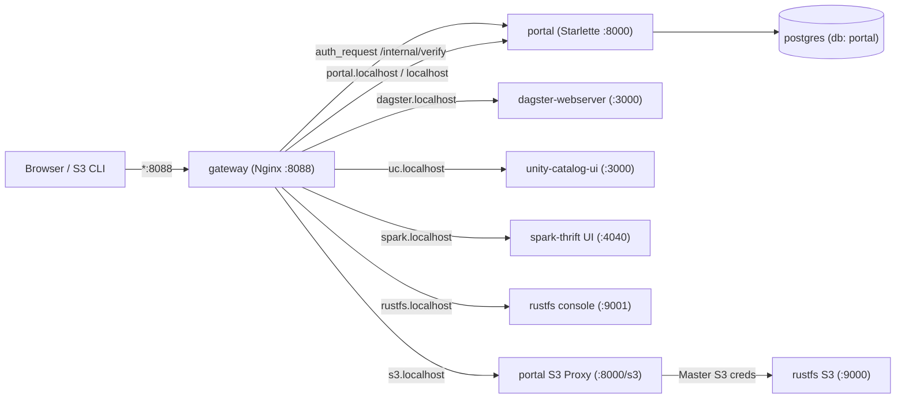

# Lakehouse Access Management Portal & Nginx Reverse Proxy Gateway

## Intent

Today every service in the Open Data Lakehouse stack exposes its own unauthenticated host port (`3000` for Dagster, `3001` for Unity Catalog UI, `9001` for RustFS Console, and Spark UI on `4040` internal). There is no unified landing page, no authentication layer, and no way to grant a user scoped access to specific web UIs or specific RustFS buckets.

This design introduces a self-contained **Access Management Portal** (`portal`) and an **Nginx Reverse Proxy Gateway** (`gateway` on port `8088`) so users authenticate once at the landing page, launch permitted services via `.localhost` subdomains, browse/upload/download permitted RustFS buckets inside the portal, and generate personal S3 access keys enforced per-bucket by an S3 SigV4 proxy.

## Goals

- Single landing page at `http://localhost:8088` / `http://portal.localhost:8088` displaying live service health and Launch buttons for **Dagster**, **Unity Catalog UI**, **Spark Thrift UI**, and **RustFS Admin Console**.
- `.localhost` subdomain routing behind Nginx (`dagster.localhost:8088`, `uc.localhost:8088`, `spark.localhost:8088`, `rustfs.localhost:8088`, `s3.localhost:8088`) to avoid SPA root-path collisions (`unity-catalog-ui` and RustFS Console both expect `/`).
- Nginx `auth_request` enforcement against `portal:8000/internal/verify?service=<slug>` with cross-subdomain SSO handoff (`/auth/handoff` -> `/__auth_callback`).
- Self-contained Postgres-backed user and RBAC management (`portal` database inside the existing `postgres` container) with a seeded admin account (`PORTAL_ADMIN_USER` / `PORTAL_ADMIN_PASSWORD`).
- In-Portal Bucket Explorer (`/buckets`) enforcing per-user `read` vs `read_write` bucket permissions.
- Personal S3 Access Key management (`/keys`) + S3 SigV4 Proxy (`s3.localhost:8088`) verifying AWS SigV4 signatures and enforcing per-bucket `read` / `read_write` permissions before forwarding to `http://rustfs:9000`.

## Non-Goals

- Replacing Unity Catalog OSS's internal catalog/schema RBAC or injecting user identities into Spark Thrift JDBC sessions.
- External OIDC/SAML IdP integration (kept self-contained in the `portal` Postgres database).

## Architecture

### Virtual Host Routing (`:8088`)

| Hostname | Upstream | Required Permission | Notes |
|---|---|---|---|
| `localhost` / `portal.localhost` | `portal:8000` | Public (`/login`, `/healthz`), Authenticated (`/`) | Landing page, Bucket Explorer, S3 Key Manager, Admin UI |
| `dagster.localhost` | `dagster-webserver:3000` | `dagster` | Proxies HTTP + GraphQL WebSockets (`Upgrade`) |
| `uc.localhost` | `unity-catalog-ui:3000` | `unity-catalog` | Serves React SPA + `/api/2.1/unity-catalog` |
| `spark.localhost` | `spark-thrift:4040` | `spark-ui` | Spark UI on dedicated subdomain |
| `rustfs.localhost` | `rustfs:9001` | `rustfs-console` (Admin) | Raw RustFS Admin Console + WebSockets |
| `s3.localhost` | `portal:8000/s3/` | Scoped S3 Access Key | SigV4 verified & bucket-scoped S3 proxy |

### Host Port Exposure

- **Removed from host `ports:`** (internal Docker network only): `dagster-webserver` (`3000`), `unity-catalog-ui` (`3001`), `rustfs` console (`9001`).
- **Kept on host `ports:`**: `gateway` (`8088:8088`), `spark-thrift` JDBC (`10000:10000`), `unity-catalog` API (`8080:8080`), `rustfs` S3 (`9000:9000`), `postgres` (`5432:5432`).

## Data Model & RBAC

Stored in a dedicated `portal` database inside `postgres` (auto-created on startup if absent):

- **`users`**: `id`, `username` (unique), `password_hash` (scrypt), `is_admin`, `is_active`, `created_at`.
- **`service_permissions`**: `id`, `user_id` (FK), `service_slug` (`dagster`, `unity-catalog`, `spark-ui`, `rustfs-console`), unique `(user_id, service_slug)`. Admins implicitly have all services.
- **`bucket_permissions`**: `id`, `user_id` (FK), `bucket_name`, `permission_level` (`read` or `read_write`), unique `(user_id, bucket_name)`. Admins implicitly have `read_write` on all buckets.
- **`s3_access_keys`**: `id`, `user_id` (FK), `access_key_id` (`LHAK...`), `secret_access_key`, `label`, `is_active`, `created_at`.

## Cross-Subdomain SSO & `auth_request`

1. Login at `portal.localhost:8088/login` sets an `HttpOnly`, `SameSite=Lax` HMAC-SHA256 signed cookie (`lh_session`).
2. Launching a service subdomain routes through `portal.localhost:8088/auth/handoff?next=<target_url>`, which mints a 60-second signed handoff token (`purpose="handoff"`) and redirects to `<target_origin>/__auth_callback?token=...&next=...`.
3. Nginx routes `/__auth_callback` directly to `portal:8000` (without `auth_request`) on every service virtual host, allowing the portal to set the `lh_session` cookie on that subdomain and redirect to `next`.
4. Subsequent requests to any service subdomain hit `auth_request /__internal/verify?service=<slug>`:
   - `200 OK` (`X-Auth-User`, `X-Auth-Admin`) -> Nginx proxies to upstream.
   - `401 Unauthorized` -> Nginx redirects to `http://portal.localhost:8088/login?next=...`.
   - `403 Forbidden` -> Nginx serves `/__internal/forbidden?service=<slug>` from `portal:8000`.

## Scoped S3 SigV4 Proxy (`s3.localhost:8088`)

1. Client (`aws` CLI or `boto3`) signs requests using personal `LHAK...` credentials against `http://s3.localhost:8088`.
2. Nginx proxies `s3.localhost` to `portal:8000/s3/`.
3. `s3_proxy.py` parses the AWS SigV4 `Authorization` header (or presigned query params), computes the canonical request and HMAC-SHA256 signing key from the stored `secret_access_key`, and validates the signature.
4. Bucket permissions are enforced:
   - `GET /` (`ListBuckets`): returns XML `<ListAllMyBucketsResult>` filtered to the user's permitted buckets.
   - `GET /<bucket>` / `GET|HEAD /<bucket>/<key>`: requires `read` or `read_write`.
   - `PUT|DELETE /<bucket>/<key>`: requires `read_write`.
   - `PUT /<bucket>` (`CreateBucket`): requires `is_admin`.
5. Authorized requests execute against RustFS via the configured `S3StorageService`; failures return standard AWS S3 XML errors (`InvalidAccessKeyId`, `SignatureDoesNotMatch`, `AccessDenied`, `NoSuchBucket`, `NoSuchKey`).

## Verification

- `pytest` unit and integration suite in `portal/tests/` covering DB seeding/RBAC, password hashing, session/handoff tokens, multipart form parsing, `/internal/verify`, Bucket Explorer, Admin matrix, and real `botocore` SigV4 requests against the S3 proxy, meeting the repo's 80% coverage gate.
- `make check` (`isort`, `black`, `flake8`, `ruff`, `mypy`, `pylint`, `dbt`, `dagster definitions validate`).
- `docker compose config -q` validation.
